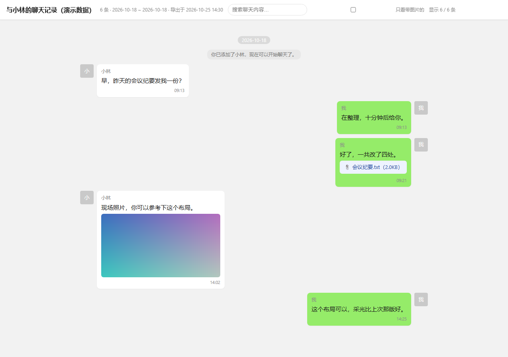

# 微信聊天记录一键导出（Windows · 微信 4.x）

[](https://github.com/zmairc/wechat-chat-export/actions/workflows/ci.yml)
[](LICENSE)


> 把**你和某个好友（或某个群）的全部聊天记录**，一键导出成可搜索的网页、纯文本和原始附件。
> 全程只读本机数据：不联网、不上传、不修改微信任何文件。

零第三方依赖 —— 只用 Python 标准库 + Windows 自带的 `bcrypt.dll`，**不需要 pip install 任何东西**。



> 上图是导出的 `chat.html`，里面的对话是虚构的示例数据（由 `python tools/demo_export.py` 生成），
> 不含任何真实聊天内容。

---

## 它能导出什么

| 输出 | 说明 |
|---|---|
| `chat.html` | 网页版聊天记录，像微信窗口一样左右分栏；**可搜索、可只看带图片的、图片点开看大图、附件点开即用**；能用浏览器「打印成 PDF」 |
| `chat.txt` | 纯文本，按日期分段，方便贴进笔记软件、Word，或拿去做文本分析 |
| `chat.csv` | 一条消息一行（时间 / 发送人 / 是否本人 / 类型 / 内容 / 引用 / 附件），UTF-8 BOM，Excel 双击就能开，适合透视表和做统计 |
| `media/` | 图片、视频、文档等附件原文件（不压缩、不转码） |

消息类型基本都能还原成人话：文本、图片、语音、视频、表情、位置、名片、通话、
引用回复、文件、转账、红包、链接、小程序、聊天记录、撤回提示、系统消息……

## 快速开始

1. **准备**：Windows 10/11 + Python 3.10+（[下载](https://www.python.org/downloads/windows/)，安装时勾选 *Add Python to PATH*）
2. **下载**：到 [Releases](https://github.com/zmairc/wechat-chat-export/releases/latest) 下载最新的 `wxchat-export-*.zip` 解压（也可以用 `Code → Download ZIP` 或 `git clone`）
3. **打开并登录微信**（微信 4.1 之后，数据库密钥只存在于运行中的微信进程内存里，关掉就拿不到）
4. **双击 `一键导出.bat`**，按提示选好友/群即可

脚本会自动完成：定位 `xwechat_files\<你的wxid>` → 从微信内存取出数据库密钥（只读
`ReadProcessMemory`，不注入、不 hook，且必须通过 page1 的 HMAC 校验才会使用）→
解密到 `work\decrypted\` → 列出会话让你选 → 导出到 `导出\<名字>_<时间>\`。

## 命令行用法

```bash
python main.py                        # 交互式选择好友
python main.py --list                 # 只列出所有会话和消息条数
python main.py --friend 张三           # 按备注/昵称/wxid 直接导出（可模糊匹配）
python main.py --friend 张三 --no-media   # 只要文字，不搬图片视频
python main.py --friend 张三 --format html,txt --out D:\导出\张三
python main.py --friend 张三 --format csv         # 只要表格，方便丢进 Excel
python main.py --selftest             # 离线自检，不读微信不联网
```

| 参数 | 说明 |
|---|---|
| `--friend / -f` | 好友或群的备注、昵称、wxid（模糊匹配，命中多个会让你选） |
| `--list` | 只列会话不导出 |
| `--out / -o` | 输出目录，默认 `导出\<名字>_<时间>` |
| `--format` | `html,txt`（默认两个都出），也可以加 `csv` |
| `--no-media` | 不导出图片/视频/文件 |
| `--media-key` | 图片解密用的 AES-128 密钥（32 位十六进制）；一般不用填，默认自动离线派生 |
| `--media-xor-key` | 图片尾段的单字节 XOR 密钥（十六进制，如 `0x26`）；只在手填 `--media-key` 时需要 |
| `--no-media-key` | 不派生图片密钥，解不开的图片按 `.dat` 原样保存 |
| `--scan-media-key` | 实验性：离线派生失败时，才去扫描微信进程内存找图片密钥（较慢） |
| `--ffmpeg` | ffmpeg.exe 路径；默认自动查找（PATH、`tools\ffmpeg.exe`、常见安装位置） |
| `--work` | 工作目录（密钥缓存 + 解密后的库），默认 `work\` |
| `--rescan` | 忽略缓存，重新从微信内存取一次密钥 |
| `--no-open` | 导完不自动打开 HTML |
| `--account` | 指定微信账号（多账号时） |
| `--yes / -y` | 自动确认，适合无人值守 |

## QQ NT 支持（实验）

同一套引擎正在往 QQ 上扩。**库结构、参数探测、逐页解密已经做完并进了自检**：

```bash
python qq_export.py probe                     # 找库、验证「1024 字节头 + 4096 页」
python qq_export.py decrypt --key <16位口令>   # 自动试参数，解密到 work/qq_decrypted/
python qq_export.py schema                    # 打印解密后的表结构
```

还差一步才能出 HTML：QQ 的 passphrase 不常驻内存，需要你提供一次（详见
[`docs/QQ.md`](docs/QQ.md)）；拿到真实样本后校准消息字段映射即可复用现有渲染。

## 工作原理

1. **找库**：扫描各磁盘定位 `xwechat_files\*\db_storage`，同一账号多份数据时挑最近的。
2. **取密钥**：微信 4.1+ 不再把密钥以明文十六进制缓存在内存，但 WCDB 的
   `com.Tencent.WCDB.Config.Cipher` 配置对象里仍留着一份做了固定字节掩码混淆的
   `x'<64hex 密钥><32hex salt>'`。工具顺着「特征字符串 → 引用节点 → 配置对象 →
   混淆 blob → 去掩码 → 正则」把它读出来，再用数据库第一页的 HMAC 校验；
   校验通过的密钥缓存到 `work\keys_*.json`，之后即使不开微信也能重复导出。
   缓存用 Windows 自带的 **DPAPI** 加密——换台机器或换个账户都解不开，也不需要
   任何第三方库；老的明文缓存会在下次运行时自动升级。
   4.0.x 老版本会自动回退到「内存里直接扫 `x'<hex>'`」的办法。
3. **解密**：SQLCipher 4（AES-256-CBC、页 4096、每页 16B IV + 64B HMAC-SHA512、保留 80B）
   逐页还原成标准 SQLite，解密后跑 `PRAGMA integrity_check`；`-wal` 只在必要时回放，
   避免把已 checkpoint 的日志重复写入导致损坏。
4. **读消息**：每个会话是一张 `Msg_<md5(用户名)>` 表，同一人分散在多个 `message_N.db`
   时自动合并；`WCDB_CT_*` 标记为压缩的字段用 zstd 解压（优先 `zstandard`，
   其次系统 Node.js 的 zlib，都没有则跳过）。
5. **落盘**：图片走 `.dat` 解密（旧 XOR / V1 / V2）。V2 的密钥不需要读进程内存——它是
   `md5(uin + wxid)[:16]` 和 `uin & 0xFF`，其中 `uin` 能从微信的 MMKV 统计文件名里读到，
   且必须用多个图片样本验证通过才会采用。解出来是 HEVC 的（`wxgf` 容器）再走一步：
   抽成标准 `.h265` + 配缩略图，有 ffmpeg 就转成 JPG。视频从 `msg\video\` 取，
   附件从 `msg\file\` 按文件名 / 消息内 md5 / 文件大小多路匹配。

## 已知限制

| 限制 | 说明 |
|---|---|
| **HEVC / wxgf 原图** | 一部分图片（实测约六成）在微信里是 HEVC 封装的原图/动图，浏览器渲染不了。工具会自动抽出 H.265 码流存成 `.h265`、并用同目录的 `_t` 缩略图做预览；本机有 ffmpeg（或 `--ffmpeg` 指定）时直接转成 JPG，画面就是完整的。 |
| 语音 / 表情 | 微信 4.x 本地基本不落盘（`Voice`/`Emoji` 目录为空），只保留 `[语音 3"]`、`[表情]` 占位 |
| 系统版本 | 仅支持 Windows + 微信 4.x；微信 3.x（`WeChat Files\Msg\MSG*.db`）格式不同，不支持 |
| 账号范围 | 只能导出本机已登录账号；密钥缓存后可离线重复导出 |
| 已删除消息 | 导不出（只在服务端） |
| zstd 压缩字段 | 约四成消息的正文/元数据是 zstd 压缩的。有 `zstandard` 模块或系统里有 Node.js（22.15+）会自动解压；两者都没有时这部分字段留空，其余内容不受影响 |

## 隐私与免责

* 全程本地运行，**不联网、不上传**，产物只在 `导出\` 目录里。
* 只读取**你自己**登录账号在本机的数据；请勿用于获取他人聊天记录或任何违法用途。
* 取密钥是**对本机内存的只读访问**，不注入、不修改、不 hook、不绕过账号安全机制。
* `work\`（密钥缓存 + 解密库）和 `导出\` 属敏感目录，不需要时直接删。
  其中密钥缓存已用 DPAPI 加密，拷到别的机器上也解不开。
* 本项目按 MIT 协议「按原样」提供，不保证长期可用；因使用本工具产生的一切后果由使用者自负。

## 开发与自检

```bash
python main.py --selftest              # 10 组断言：AES / SQLCipher / .dat / 渲染 /
                                       # 图片密钥 / HEVC / CSV / 密钥缓存 / QQ 库结构
python -m unittest discover -s tests   # 同一批断言，CI 里跑的就是这个
```

自检自己造密文再解密，**不读微信、不联网、不需要第三方库**，读代码时也能直接验证它确实只是在做解密和搬运。
CI（`.github/workflows/ci.yml`）在 Windows + Python 3.11~3.13 上跑这套自检。

想接着往下做（或者照它给 QQ / 抖音 之类写一个导出工具）？先看
[`docs/ARCHITECTURE.md`](docs/ARCHITECTURE.md)——数据流、哪些模块能直接复用、哪些是微信专属
必须重写、以及作者踩过的坑，都在里面。

GitHub 上同类项目的对比、可以借鉴的算法（尤其图片密钥的离线派生）见
[`docs/REFERENCES.md`](docs/REFERENCES.md)。

想把这套东西扩展到 QQ / 飞书 / 钉钉 / 抖音，或者做成手机 App？先读
[`docs/LESSONS.md`](docs/LESSONS.md)（所有踩过的坑）和
[`docs/ROADMAP.md`](docs/ROADMAP.md)（多平台与移动端路线图、平台可行性矩阵）。

## 目录结构

```
一键导出.bat            双击入口
main.py                 命令行入口（--selftest 也在这）
qq_export.py            QQ NT 入口（probe / decrypt / schema）
wxexport/
  cli.py                交互/参数、选好友、导出流程
  pipeline.py           找数据目录、密钥缓存、批量解密
  wcdb41.py             微信 4.1+ Config.Cipher 取密钥
  keyscan.py            内存扫描基础库
  keyextract.py         取密钥总入口（新路线 + 老路线回退）
  sqlcipher.py          SQLCipher 4 页面解密 / WAL / 完整性校验
  cng_aes.py            AES（Windows CNG，纯 Python 兜底）
  dpapi.py              密钥缓存加密（Windows DPAPI，绑当前用户+机器）
  wxstore.py            联系人、会话索引、消息读取
  wxmsg.py              消息内容解析
  zstd_codec.py         zstd 解压（zstandard / Node.js）
  media.py              图片 .dat 解密、视频/文件搬运
  imagekey.py           图片密钥离线派生（uin → AES / XOR 密钥 + 样本验证）
  hevc.py               HEVC/wxgf 抽流与转码（有 ffmpeg 才转，没有就抽流 + 缩略图）
  qq.py                 QQ NT：1024 字节头、SQLCipher 参数探测、逐页解密
  exporter.py           HTML / TXT 渲染
  selftest.py           离线自检
  mediakey.py           [实验性] 内存里找图片密钥
tests/                  unittest
tools/
  ci_rerun.py           CI 辅助（查看 / 重跑 / 抓失败日志）
  demo_export.py        生成虚构的演示页面（用来截 README 截图）
.github/workflows/      CI
docs/ARCHITECTURE.md    架构说明与「接新平台」指南
docs/LESSONS.md         所有踩过的坑（换平台前必读）
docs/ROADMAP.md         多平台 + 移动端的可行性矩阵与路线图
docs/QQ.md              QQ NT 的实测结论与当前边界
docs/REFERENCES.md      同类项目调研、可借鉴的算法与实测结论
work/                   密钥缓存 + 解密后的数据库（敏感，可删）
导出/                   导出结果
```

## 常见问题

**Q：提示「没有检测到正在运行的微信」？**
A：先打开微信并登录再运行，密钥只在运行时内存里。

**Q：提示「打不开进程」？**
A：用与微信相同的用户运行；个别环境（微信以管理员启动）需要本工具也以管理员运行。

**Q：导出要多久？**
A：纯文字几秒到几十秒；带媒体取决于附件大小（实测 5500 条 + 300 张图十几秒）。

**Q：会封号吗？**
A：工具只读本机数据库文件和微信进程内存，不修改微信行为、不接触服务器通信。

**Q：图片导出成了 `.hevc` / `.h265`，打不开？**
A：那是微信用 HEVC 封装的原图/动图。现在默认会：①用同一张图的缩略图做预览，HTML 里能直接看；
②把原图抽成标准 `.h265`（VLC、PotPlayer、MPV 都能播）。想直接在网页里看到清晰原图，
装个 [ffmpeg](https://ffmpeg.org/download.html) 放到 PATH（或 `tools\ffmpeg.exe`，或 `--ffmpeg` 指路），
重跑一次就会自动转成 JPG。

**Q：导出的 HTML 能发给别人吗？**
A：可以，但里面是你自己的聊天内容；`media/` 目录要一起带上，页面里的图片是相对路径。

## 致谢

* WCDB / SQLCipher 的公开格式说明（页大小、HMAC、KDF 参数）
* 社区里关于微信 4.x 数据库与 `.dat` 图片格式的公开讨论，帮助确认了字段与偏移
* 早期同类工具的思路启发（多数已停更或下架，本项目为独立实现）

## License

[MIT](LICENSE)
